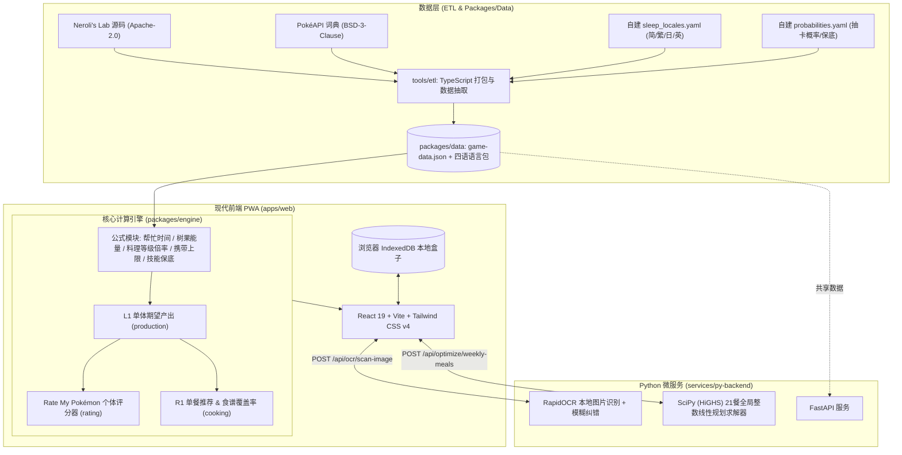

# Pokémon Sleep 游戏助手 (PokéSleep Companion Toolkit)

<p align="center">
  <span style="font-size: 48px;">💤⚡🍲</span>
  <br />
  <strong>高精度、离线优先、开源合规的 Pokémon Sleep 混合架构辅助工作台</strong>
  <br />
  <sub>TypeScript 核心计算引擎 + Python OCR 识别与线性规划排程 + React PWA 现代化交互面板</sub>
</p>

<p align="center">
  
  
  
  
  
  
  
  
  
  
</p>

---

## 🌟 核心特性

- 📦 **宝可梦盒整理 (Box Manager)**
  - 基于浏览器原生 **IndexedDB** 实现本地离线存储，支持记录每只宝可梦的当前等级、昵称、主技能等级与缎带，数据永不上传云端。
  - **卡片一键编辑与官方立绘展示**：支持随时编辑盒中已有宝可梦配置，全面集成宝可梦、树果、食材、属性、主技能与料理官方高清图标。
  - **多维检索筛选器**：支持按名称/图鉴号、专长（树果/食材/技能/全能）、18 种宝可梦属性（对应树果）、19 种产食材与进化阶段组合快速检索。
  - **帕累托压制分析（送走建议）** 与 **JSON 导入/导出** 备份。

- 📸 **多语言截图与无扩展名图片 OCR (RapidOCR + RP 反推)**
  - 基于本地轻量 ONNX 模型的 `RapidOCR`，支持任意图片文件选择（包括无扩展名截图）、拖拽上传与剪贴板 `Ctrl+V` 粘贴识别。
  - 採用 **CLAHE 对比度增强 + 3×2 二维网格几何定位**，精准提取物种、等级、`SP (RP)`、主技能等级、携带上限、性格及副技能（`Lv.10 / 25 / 50 / 70 / 80`）。
  - **精确 SP 反推屏幕外食材槽**：利用游戏内精确 `SP (RP)` 公式自动反推截图中未露出的第 2/3 食材槽配置。

- 🌟 **全阶段自动个体分析与专长深度拆解 (Rate My Pokémon)**
  - **免输当前等级，全阶段自动评估**：自动横跨 **`Lv.10`、`Lv.25`、`Lv.30`、`Lv.50`、`Lv.60`、`Lv.70`（当前版本满级上限，解锁第 4 副技能）** 六大关键节点计算精确全组合去重加权 PR 百分位。
  - **三大专长专属深度分析面板**：
    - **技能型专长**：分析每日期望技能触发次数、基础/修正/保底后触发率、有效主技能等级（自动计入解锁的 `技能等级提升S/M`）及每次/每日具体量化收益（树果遽增、活力全开、能量填充、料理强化、食材获取等）。
    - **树果型专长**：分析树果日能量与总能量、单次掉落数、卡比兽喜好树果（2×）与岛屿加成对比、满包偷吃（Sneaky Snacking）纯树果日能量及装满携带上限所需时长。
    - **食材型与技能产食材专长**：分析各槽位食材日产量/能量获取效率，并将**主技能获取食材（如水伊布的食材获取S、穿山鼠的食材抽选S等）全量同步计入单宠食谱覆盖率**（咖喱 / 沙拉 / 甜点三大类一日三餐自给率与高阶食谱契合度排名）。

- 🍲 **队伍能量与料理规划 (Team Energy & Cooking Planner)**
  - 支持配置 5 宠出阵队伍，自动计算每日树果、食材、主技能期望产出及每日卡比兽总能量贡献。
  - **R1 单餐最优食谱推荐**：根据当前锅容量、好露营券加成、岛屿加成与现有食材库存，贪心匹配本餐能量最大化的食谱并以最高能量余料填满锅容量。
  - **R2 21 餐周料理整数线性规划 (HiGHS / SciPy MILP)**：对整周 21 餐（周一至周六 18 餐 + 周日 3 餐）进行全局最优求解，精确考虑周日锅容量 $\times 2$ 与周日大成功暴击倍率，并在食材随时间连续流入约束下最大化全周总料理能量。

- 🌐 **四语无缝切换与严谨合规图鉴**
  - 原生支持 **简体中文 (`zh-CN`)**、**繁體中文 (`zh-TW`)**、**日本語 (`ja`)** 与 **English (`en`)**，默认简中，全局无刷新热切换。
  - 内置全图鉴（宝可梦、食材、食谱与升级能量加成表 Lv.1–70），并附有详尽的开源协议致谢页面。

---

## 🏛️ 系统架构

本项目采用 **TypeScript 前端/核心引擎 + Python 视觉与复杂优化微服务** 的混合架构（Monorepo）：



### 目录结构

```text
pokesleep-assistant/
├── apps/
│   └── web/                     # React 19 + Vite + Tailwind v4 PWA 应用
│       ├── src/components/      # 盒子管理、PR 评估、队伍与料理、图鉴组件
│       ├── src/storage/db.ts    # 浏览器 IndexedDB 盒子本地持久化
│       └── src/i18n/            # 简中 / 繁中 / 日文 / 英文国际化字典
├── packages/
│   ├── data/                    # 静态游戏数据与 O(1) 检索库
│   │   ├── src/generated/       # ETL 生成的 game-data.json 与四语词库
│   │   └── src/index.ts         # 强类型导出与多语言查询
│   └── engine/                  # TypeScript 无依赖核心计算引擎
│       ├── src/formula/         # 基础数值公式 (频率/树果/料理/锅容量/技能)
│       ├── src/production/      # L1 单体日产出与保底机制 (PPHC)
│       ├── src/rating/          # Rate my Pokémon 个体评分与去重
│       └── src/cooking/         # 食谱覆盖率与 R1 贪心单餐推荐
├── services/
│   └── py-backend/              # Python FastAPI 微服务
│       ├── ocr/                 # RapidOCR 截图解析与词典模糊纠错
│       ├── optimizer/           # R2 21 餐周料理排程整数线性规划 (HiGHS)
│       ├── data_loader.py       # 共享加载 packages/data 游戏字典
│       └── test_main.py         # Pytest 接口与求解器单元测试
├── tools/
│   └── etl/                     # 数据构建管道 (抓取/合并/规范化 JSON)
├── data-sources/                # 自建多语言词典、经验表与抽卡概率 YAML
├── ATTRIBUTION.md               # 严谨的开源协议与第三方致谢声明
└── package.json                 # Monorepo 统一任务脚本配置
```

---

## 🚀 快速上手

### 1. 环境准备

- **Node.js** >= 20.0.0
- **pnpm** >= 9.0.0
- **Python** >= 3.11（推荐使用 `uv` 极速包管理器）

### 2. 克隆仓库与依赖安装

```bash
git clone https://github.com/sanchoo1/pokesleep-assistant.git
cd pokesleep-assistant

# 1. 安装 Node.js Monorepo 依赖
pnpm install

# 2. 安装 Python 微服务依赖 (使用 uv 或 pip)
pnpm run py:install
```

### 3. 一键并发启动开发服务

```bash
pnpm dev
```

该命令将使用 `concurrently` 同时启动：
- **Web 前端**：`http://localhost:5173`（支持 PWA 本地运行）
- **Python 微服务**：`http://localhost:8000`（API 文档：`http://localhost:8000/docs`）

---

## 🧪 自动化测试与跨源交叉验证流水线

项目内置了面向新版本、新宝可梦与核心公式回归的**黄金验证集与跨源交叉验证流水线**（见 [`.github/workflows/ci.yml`](./.github/workflows/ci.yml)）：
- 使用 [`tools/etl/generate_golden_dataset.mjs`](./tools/etl/generate_golden_dataset.mjs) 基于固定随机种子与真实截图算例生成 **30 个代表性个体**（覆盖树果 / 食材 / 技能 / 全能专长、Lv.8–Lv.70、缎带、好露营券、技能升级副技能与多种主技能），与 **Neroli's Lab (`sleepapi-common`)**、**RaenonX 公式**及游戏内实机 `SP` 面板交叉核验。

```bash
# 重新从上游参考源生成 30 个代表性个体的黄金交叉验证集
pnpm run validate:generate

# 一键运行全栈测试 (74 个 Vitest 交叉验证与引擎算例 + 7 个 pytest OCR/RP/MILP 测试)
pnpm run test:all

# 单独运行 TypeScript 引擎与交叉验证套件 (Vitest)
pnpm test

# 单独运行 Python 后端 OCR、精确 RP 反推与线性规划测试 (pytest)
pnpm run test:py

# 全栈前端生产环境构建
pnpm run build
```

---

## ⚖️ 开源协议与合规声明 (Attribution & Compliance)

> [!IMPORTANT]
> **本工具严格遵守开源合规与反作弊准则，绝对不包含对 Pokémon Sleep 客户端的非法反编译、逆向工程或网络封包嗅探。**

所有数据均来自于合规公开社区研究成果与宽松开源项目，详见根目录 [`ATTRIBUTION.md`](./ATTRIBUTION.md)：

1. **[Neroli's Lab](https://github.com/nerolis-lab/nerolis-lab)** (**Apache-2.0 License**)
   - 提供宝可梦基础面板、副技能、性格、树果、食材、食谱等级加成公式（Lv.1–70）、技能保底阈值（PPHC）与晚安缎带数值模型。
2. **[PokéAPI](https://github.com/PokeAPI/pokeapi)** (**BSD-3-Clause License**)
   - 提供宝可梦物种名称、性格名称及树果名称的官方多语言（中/繁/日/英）映射。
3. **[Mathcord RP Project](https://discord.gg/pokemonsleep) & [RaenonX](https://pks.raenonx.cc)** (社区客观公开研究成果)
   - 提供副技能金/银/白分布概率、食材槽抽取概率、隐藏食材发现率与技能发动率推算基准。
4. **PokéSleep Assistant 自建多语言词库** (Copyright © 2026 PokéSleep Assistant Team)
   - 对照官方游戏内文本独立整理的 17 种副技能、19 种食材、78 道食谱与主技能四语规范词典及 OCR 别名库。

*Pokémon 以及相关角色名称为 Nintendo、Creatures Inc.、GAME FREAK inc. 及 The Pokémon Company 的注册商标。本项目为非营利性开源辅助工具，与官方机构无任何关联。*

